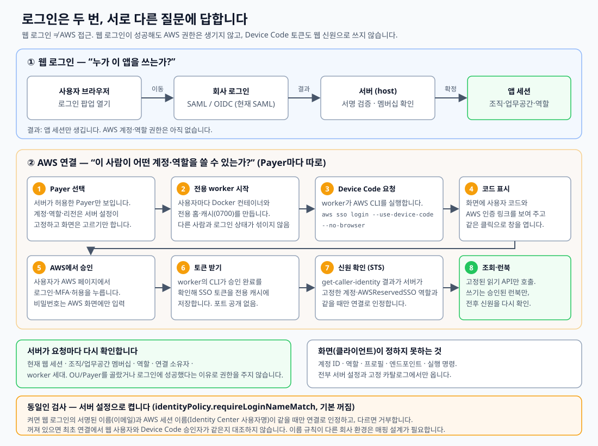

# 인증 흐름 한눈에 보기



핵심은 한 문장입니다.

> **SSO 로그인 명령 자체보다, 여러 사람이 쓰는 서버에서 그 로그인 상태를 섞이지 않게 관리하는 것이 구현의 핵심입니다.**

## 두 로그인은 서로 다른 질문에 답한다

| 단계 | 질문 | 결과 | 하지 않는 것 |
|---|---|---|---|
| ① 웹 로그인 | 누가 이 앱을 쓰는가? | 앱 세션(조직·업무공간·역할) | AWS 권한을 주지 않음 |
| ② AWS 연결 | 이 사람이 어떤 계정·역할을 쓸 수 있는가? | 사용자 전용 worker의 AWS 임시 자격증명 | 웹 신원으로 쓰지 않음 |

AWS Device Code로 받는 SSO 토큰은 웹 로그인용 ID 토큰이 아닙니다(AWS `CreateToken`은 `idToken`을 지원하지 않습니다). 그래서 두 단계를 분리해 둡니다. 회사에 이미 승인된 웹 인증이 있으면 ①은 그대로 두고 ②만 붙이면 됩니다. [AWS 문서](https://docs.aws.amazon.com/singlesignon/latest/OIDCAPIReference/API_CreateToken.html)

## ② AWS 연결을 단계별로

1. **Payer 선택.** 서버가 이 사용자에게 허용한 Payer만 목록에 나옵니다. 계정 ID·역할·리전은 서버 설정이 고정하고, 화면은 고르기만 합니다.
2. **전용 worker 시작.** 사용자마다 Docker 컨테이너와 전용 홈·캐시를 만듭니다. 디렉터리 `0700`, 파일 `0600`, 소유자·심볼릭 링크 검사, 부모 프로세스의 AWS 자격증명 변수와 EC2 인스턴스 역할(`AWS_EC2_METADATA_DISABLED`)을 막는 고정 실행 환경을 씁니다. 공용 홈이나 요청별 전역 `AWS_PROFILE` 변경은 쓰지 않습니다.
3. **Device Code 요청.** worker가 AWS CLI를 실행합니다.
   ```sh
   aws sso login --profile <고정 프로필> --use-device-code --no-browser
   ```
   `--no-browser`는 worker에서 브라우저를 열지 말라는 뜻이고, `--use-device-code`는 Device Code 방식을 쓰라는 뜻입니다. AWS CLI 2.22.0부터 PKCE가 기본이라 Device Code를 쓰려면 명시해야 합니다. [AWS 문서](https://docs.aws.amazon.com/cli/latest/reference/sso/login.html)
4. **코드 표시.** worker가 읽은 사용자 코드와 인증 링크를 화면에 보여 줍니다. 버튼 한 번으로 창을 열고 코드가 담긴 링크로 보냅니다.
5. **AWS에서 승인.** 사용자가 AWS 페이지에서 로그인·MFA·허용을 누릅니다. 비밀번호와 MFA는 AWS(또는 회사 로그인) 화면에만 입력합니다.
6. **토큰 받기.** 서버는 브라우저가 승인했는지 모릅니다. worker의 CLI가 AWS 쪽으로 승인 완료를 확인(polling)해 SSO 토큰을 전용 캐시에 저장합니다. 프로토콜은 `RegisterClient → StartDeviceAuthorization → CreateToken`, 이후 `GetRoleCredentials`로 할당된 역할의 임시 자격증명을 얻습니다. 이 과정을 CLI에 맡겼기 때문에 **worker에 브라우저 콜백 포트를 공개하지 않습니다.** 다만 웹 앱 접속과 SAML ACS는 별개라서 "서비스 전체가 인바운드 없이 동작한다"는 뜻은 아닙니다. [AWS 문서](https://docs.aws.amazon.com/singlesignon/latest/OIDCAPIReference/API_StartDeviceAuthorization.html)
7. **신원 확인.** 로그인이 끝났다고 바로 쓰지 않고 `aws sts get-caller-identity` 결과를 검사합니다. 계정 ID와 `AWSReservedSSO_<역할>_` 접두사가 서버가 고정한 값과 같아야 연결로 인정합니다(`checkedCliIdentity`). 이후 동기화와 런북은 이 신원을 고정해 두고, 실행 전후에 바뀌었는지 다시 비교합니다.
8. **조회·런북.** 고정된 읽기 API만 호출합니다. 쓰기는 서버 고정 카탈로그의 런북을 요청 → 승인 → 요청자 본인 세션으로만 실행합니다.

SSO 설정은 서버 설정에서 만들며 모양은 아래와 같습니다(값은 설명용).

```ini
[sso-session cloudops-user]
sso_start_url = https://YOUR-PORTAL.awsapps.com/start
sso_region = us-east-1
sso_registration_scopes = sso:account:access

[profile cloudops-read]
sso_session = cloudops-user
sso_account_id = 111122223333
sso_role_name = CloudOpsReadOnly
region = us-east-1
```

`sso_region`은 Identity Center가 있는 리전이고, 프로필 `region`은 조회 대상의 기본 리전이라 같을 필요가 없습니다. 역할 이름을 적는다고 권한이 생기지 않으며, 실제로 그 사용자에게 할당된 계정·Permission Set이어야 합니다. [AWS 문서](https://docs.aws.amazon.com/cli/latest/userguide/cli-configure-sso.html)

## 코드에서 읽을 곳 네 군데

| 위치 | 설명할 핵심 |
|---|---|
| `packages/worker-protocol/cli-contract.ts` | 고정 SSO 설정·명령 생성, 인증 URL 검증, STS 결과 검증, 런북 명령 |
| `apps/worker/src/cli-runtime.ts` | 사용자 전용 캐시·파일 권한·환경변수 격리, CLI 실행 |
| `apps/worker/src/cli-worker.ts` | 로그인 시작 → 승인 대기 → STS 확인 → 연결 상태 관리 |
| [`identity.md`](identity.md) | 웹 인증과 AWS 연결의 차이, 회사가 정해야 할 조건 |

## 아직 닫히지 않은 것 (정직한 한계)

- **웹 사용자와 AWS 승인자의 동일성.** 두 로그인이 같은 Identity Center 디렉터리를 쓴다고 같은 사람이라는 보장은 없습니다. 웹에는 A가 로그인했는데 Device Code를 B가 승인하면 A의 연결이 B의 AWS 권한으로 만들어질 수 있습니다. 서버 설정 `identityPolicy.requireLoginNameMatch`를 켜면 막습니다. 웹 로그인의 서명된 로그인 이름이 연결 binding에 서버 값으로 들어가고, worker가 STS 확인 때 AWS 세션 이름(ARN 마지막 구간)과 비교해 다르면 `web_identity_mismatch`로 거부합니다. **기본은 꺼짐**이고, 두 이름이 같은 값일 때만 쓸 수 있습니다(개인 테스트 계정은 같음). 다르면 매핑 규칙이 필요하고 이는 미구현입니다. 상세는 [배포 문서](../../deploy/organization-api.md)에 있습니다.
- **사람의 SSO 세션 ≠ 상시 자동화 인증.** 지금 방식은 로그인한 사람이 자기 권한으로 조회하는 도구에 맞습니다. 예약 수집을 무인으로 돌리거나 공용 서비스 계정으로 운영하려면 workload IAM role 기반 임시 자격증명과 계정 간 접근 구조를 따로 설계해야 합니다. [AWS 문서](https://docs.aws.amazon.com/IAM/latest/UserGuide/best-practices.html)
- **조회 범위.** 동기화는 태그된 VPC가 있는 리전과 Payer 기본 리전을 중심으로 읽습니다. 호출량을 줄이는 정책이지 "전체 자산" 규칙이 아닙니다(VPC에 연결하지 않은 Lambda는 해당 리전에 있어도 놓칠 수 있음). 화면은 "설정된 수집 범위의 현황"으로 이해해야 합니다.
- **검증 환경.** 실제 AWS 확인은 개인 테스트 Identity Center와 로컬 Docker 기준입니다. 다계정·회사 환경에서 검증하지 않았습니다.
